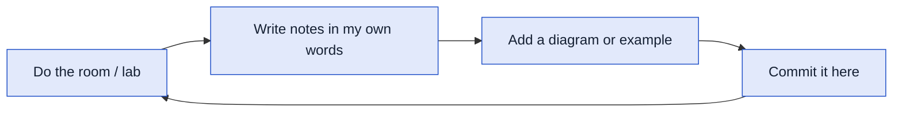

# 🛡️ Cybersecurity Notes

Hi, I'm Mary. I work in IT support with hands-on healthcare IT experience (EMR systems, Google Workspace, and medical devices), and I'm moving into **defensive security / SOC analysis**.

This repo is my learning log. Every entry here is something I actually studied or did, written up in my own words.

> [!NOTE]
> **Currently working on:** TryHackMe *Cyber Security 101* path · preparing for CompTIA Security+

---

## 📚 What's inside

| Folder | What it holds |
|---|---|
| [`tryhackme/`](tryhackme/) | Notes from TryHackMe rooms, organized by path and module |
| [`security-plus/`](security-plus/) | Security+ study notes by exam domain |
| [`writeups/`](writeups/) | Deeper write-ups of labs and investigations |

## ✅ Progress

### TryHackMe · Cyber Security 101
| Module | Status |
|---|---|
| [Defensive Security](tryhackme/cyber-security-101/defensive-security/) | ✅ Complete (5 rooms) |

### Projects
- [Wireshark Network Analysis](https://github.com/MaryShiko/Wireshark-network-Analysis) · DNS and HTTP packet analysis

---

## 🧭 How I learn

One tangible thing, every day.
