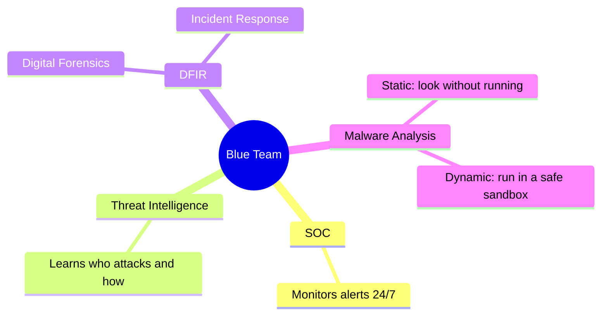

# 1 · Defensive Security Intro

> [!NOTE]
> **In one sentence:** Defensive security (the blue team) is about stopping attacks before they happen and catching and handling the ones that get through.

## 🏠 Think of it like this

A house: the **red team** is a hired burglar testing your locks. The **blue team** installs the locks, alarms and cameras, watches the cameras, and calls for help when something moves.

---

<b>🔴 Red team vs 🔵 Blue team</b>

| | Red team | Blue team |
|---|---|---|
| Role | Offensive: acts like an attacker | Defensive: protects the organization |
| Goal | Find weaknesses before real attackers do | Prevent, detect, and respond to attacks |
| Examples | Penetration testing, red team exercises | SOC analysis, incident response, forensics |

<b>🧱 Two jobs of defensive security</b>

1. **Prevent** intrusions: firewalls, patching, user training, access control.
2. **Detect and respond** to intrusions that still happen: monitoring, alerts, investigation.

Prevention is never perfect, so detection matters just as much.

<b>🗂️ Main areas of the blue team</b>

- **Security Operations Center (SOC):** a team that monitors systems and networks around the clock.
- **Threat intelligence:** collecting information about attackers (their tools, IPs, methods) so you can defend against them in advance.
- **DFIR:** digital forensics (collect evidence) and incident response (handle the attack).
- **Malware analysis:** figuring out what a malicious file does.

<b>🧪 What the lab showed</b>

The room's lab walks through a simple SOC flow:

1. A **SIEM** dashboard raises an alert for suspicious activity.
2. The analyst checks the source IP against **threat intelligence** to see if it's known to be malicious.
3. If it is, the analyst **escalates** and the IP gets **blocked at the firewall**.

That's the whole blue team loop in miniature: alert → investigate → respond.

## 🔑 Key terms
`Blue team` · `Red team` · `SOC` · `SIEM` · `Threat intelligence` · `DFIR` · `Malware analysis`

## 💭 My takeaway
_Add a line in your own words: what clicked for you in this room?_
