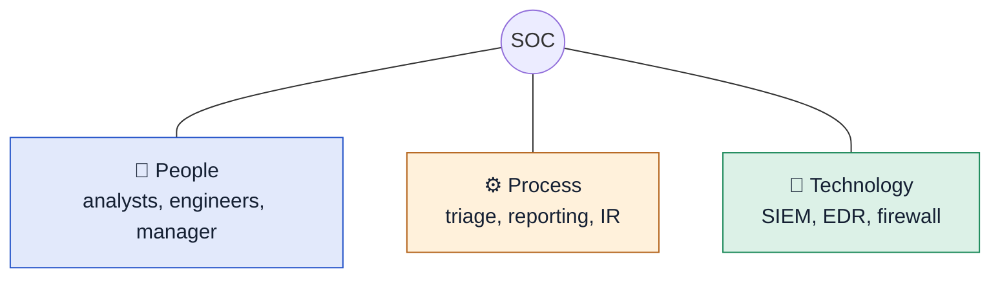

# 2 · SOC Fundamentals

> [!NOTE]
> **In one sentence:** A Security Operations Center (SOC) is a team that watches an organization's systems around the clock, spots threats, and starts the response.

## 🚒 Think of it like this

A 911 dispatch center. Calls (alerts) come in all day. Dispatchers (L1 analysts) decide which are real emergencies, send them up to specialists, and ignore the prank calls (false positives).

---

<b>🎯 What a SOC does</b>

- **Detection:** spot vulnerabilities, unauthorized activity, policy violations, and intrusions.
- **Response:** support the incident response process once something real is found.

<b>👥 People · ⚙️ Process · 🧰 Technology</b>

A SOC rests on three pillars:

**People: the SOC team**

| Role | What they do |
|---|---|
| **L1 analyst** | First line. Triages alerts, closes false positives, escalates real ones |
| **L2 analyst** | Deeper investigation, correlates data across sources |
| **L3 analyst** | Senior. Threat hunting and handling serious incidents |
| **Security engineer** | Builds and maintains the SOC's tools |
| **Detection engineer** | Writes the rules that generate alerts |
| **SOC manager** | Runs the team and reports to leadership |

> [!TIP]
> L1 SOC analyst is the most common entry-level security role. This is the job to aim for first.

**Process: alert triage with the 5 W's**

When an alert comes in, answer:
- **What** happened?
- **When** did it happen?
- **Where** did it happen (which host, which user)?
- **Who** was involved?
- **Why** did it happen?

Then: report it, escalate if needed, and support incident response.

**Technology**
- **SIEM:** collects logs from everywhere and raises alerts when rules match.
- **EDR:** watches endpoints (laptops, servers) and can isolate them.
- **Firewall:** filters network traffic in and out.

<b>✅ True positive vs ❌ False positive</b>

| | Meaning | Example |
|---|---|---|
| **True positive** | Alert fired and it really is malicious | Alert on malware download, and it is malware |
| **False positive** | Alert fired but it's harmless | Alert on "suspicious login," but it's the user on a new laptop |

A big part of L1 work is telling these apart quickly and accurately.

## 🔑 Key terms
`SOC` · `L1/L2/L3` · `Triage` · `5 W's` · `SIEM` · `EDR` · `True positive` · `False positive`

## 💭 My takeaway
A SOC alert queue works a lot like the IT support ticket queue I already handle every day: triage what comes in, close what's harmless, escalate what's real. L1 SOC analyst is the role I'm aiming for first.
