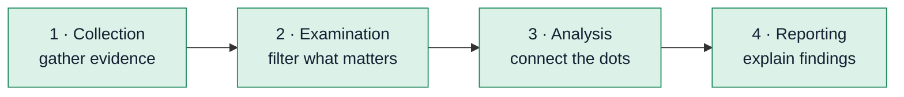

# 3 · Digital Forensics Fundamentals

> [!NOTE]
> **In one sentence:** Digital forensics is collecting and examining digital evidence in a way that doesn't change it, so the findings can be trusted (even in court).

## 🕵️ Think of it like this

A crime scene investigator. You photograph and bag the evidence before touching anything, label who handled it and when, and only then study it in the lab.

---

<details>
<summary><b>🔄 The forensics process (NIST)</b></summary>



</details>

<details>
<summary><b>📂 Types of digital forensics</b></summary>

- **Computer forensics:** laptops and desktops (the most common)
- **Mobile forensics:** phones and tablets
- **Network forensics:** traffic between systems
- **Database forensics:** changes to stored data
- **Cloud forensics:** data in cloud services
- **Email forensics:** headers, senders, attachments (big for phishing cases)

</details>

<details>
<summary><b>🧾 Handling evidence correctly</b></summary>

| Practice | Why it matters |
|---|---|
| **Proper authorization** | You need permission before collecting anything |
| **Chain of custody** | A record of who had the evidence, when, and why. Gaps can make evidence unusable |
| **Write blocker** | Hardware/software that lets you read a drive without writing to it |

> [!IMPORTANT]
> Rule #1: never work on the original. Make a copy (an image) and analyze the copy.

</details>

<details>
<summary><b>💾 Disk image vs 🧠 memory image</b></summary>

| | Disk image | Memory (RAM) image |
|---|---|---|
| What it captures | Everything stored on the drive | What was running at that moment |
| Survives a reboot? | Yes | **No**, so capture it first |
| Example tools | FTK Imager, Autopsy | DumpIt, Volatility (analysis) |

</details>

<details>
<summary><b>🧪 What the lab showed: metadata</b></summary>

Files carry hidden **metadata** that can reveal a lot:
- **PDFs:** author, creation date, software used. Tool: `pdfinfo`
- **Photos:** camera model, date taken, sometimes **GPS location**. Tool: `exiftool`

```bash
pdfinfo document.pdf
exiftool photo.jpg
```

</details>

## 🔑 Key terms
`Chain of custody` · `Write blocker` · `Disk image` · `Memory image` · `Metadata` · `exiftool` · `pdfinfo`

## 💭 My takeaway
_Add a line in your own words._
