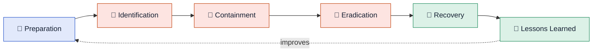

# 4 · Incident Response Fundamentals

> [!NOTE]
> **In one sentence:** Incident response (IR) is the planned, step-by-step way a team handles a security incident, from spotting it to cleaning up and learning from it.

## 🔥 Think of it like this

A kitchen fire. You keep an extinguisher ready (preparation), notice the smoke (identification), shut the door so it doesn't spread (containment), put it out (eradication), clean up and cook again (recovery), and figure out what caused it (lessons learned).

---

<b>📍 Event vs incident</b>

- **Event:** anything that happens on a system (a login, a file opened). Most are normal.
- **Incident:** an event that harms or threatens security (malware runs, data is stolen).

Every incident is an event, but most events are not incidents.

<b>☠️ Common incident types</b>

- **Malware:** viruses, ransomware, trojans
- **Phishing:** tricking users into clicking or giving up credentials
- **Denial of service (DoS):** flooding a service so it goes down
- **Data breach:** unauthorized access to sensitive data
- **Insider threat:** harm caused by someone inside the organization
- **Unauthorized access:** someone gets in who shouldn't

Incidents are ranked by **severity** (low → critical) so the worst get handled first.

<b>🔄 The IR process: SANS (PICERL)</b>

| Step | What happens |
|---|---|
| **Preparation** | Plans, tools, and trained people ready before anything happens |
| **Identification** | Detect the incident and confirm it's real |
| **Containment** | Stop it spreading (isolate the host, disable the account) |
| **Eradication** | Remove the threat completely (delete malware, close the hole) |
| **Recovery** | Restore systems to normal and monitor them |
| **Lessons learned** | Review what happened and improve |

> [!TIP]
> Memory trick: **P**lease **I**nvestigate **C**arefully, **E**very **R**isk **L**eft.

<b>🏛️ NIST version (4 phases)</b>

NIST groups the same ideas into four phases:

1. Preparation
2. Detection & Analysis
3. Containment, Eradication & Recovery
4. Post-Incident Activity

Same process, packaged differently. Know both for Security+.

<b>📘 Playbook vs runbook</b>

| | Playbook | Runbook |
|---|---|---|
| Level | High-level guide | Detailed step-by-step instructions |
| Example | "How we handle phishing incidents" | "Exact steps to pull a phishing email from all inboxes" |

## 🔑 Key terms
`Event` · `Incident` · `Severity` · `PICERL` · `NIST IR lifecycle` · `Containment` · `Playbook` · `Runbook`

## 💭 My takeaway
Incident response is a process, not a panic. Working in healthcare IT, I can see why containment matters so much: when clinical systems are involved, stopping the spread fast protects patients as well as data.
