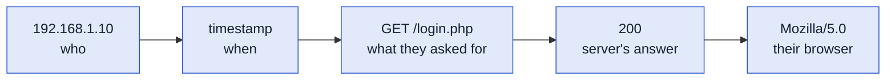

# 5 · Logs Fundamentals

> [!NOTE]
> **In one sentence:** Logs are the records systems keep of what happened, and reading them is how analysts reconstruct an attack.

## 📒 Think of it like this

A building's sign-in sheet and security camera footage. Who came in, when, through which door, and what they did. If something goes missing, that's where you look first.

---

<details>
<summary><b>❓ Why logs matter</b></summary>

- **Security monitoring:** spot suspicious activity as it happens
- **Incident investigation:** rebuild the timeline of an attack
- **Troubleshooting:** find why something broke (familiar from IT support!)
- **Compliance:** many regulations require keeping logs (HIPAA in healthcare is one)

</details>

<details>
<summary><b>🗂️ Types of logs</b></summary>

| Log type | What it records |
|---|---|
| **System** | OS events: startups, shutdowns, driver issues |
| **Security** | Logins, permission changes, policy changes |
| **Application** | Events from specific apps (errors, actions) |
| **Audit** | Who did what, for accountability |
| **Network** | Traffic through firewalls, routers, proxies |
| **Access** | Who accessed a resource, like a web server |

</details>

<details>
<summary><b>🪟 Windows Event IDs worth memorizing</b></summary>

Windows logs are viewed in **Event Viewer** (`eventvwr.msc`).

| Event ID | Meaning | Why it matters |
|---|---|---|
| **4624** | Successful logon | Who got in, and when |
| **4625** | Failed logon | Many in a row = possible brute force |
| **4634** | Logoff | End of a session |
| **4720** | User account created | Attackers create accounts to stay in |
| **4722** | User account enabled | |
| **4724** | Password reset attempt | |
| **4725** | User account disabled | |
| **4726** | User account deleted | |

> [!WARNING]
> Pattern to remember: lots of **4625** failures followed by a **4624** success from the same source often means a brute-force attack worked.

</details>

<details>
<summary><b>🌐 Reading a web server access log</b></summary>

A line from an Apache/Nginx `access.log`:

```
192.168.1.10 - - [13/Oct/2026:19:01:22 -0700] "GET /login.php HTTP/1.1" 200 512 "-" "Mozilla/5.0"
```



**Spotting attacks in web logs**
- `' OR 1=1` or `UNION SELECT` in the URL → **SQL injection** attempt
- `../../etc/passwd` → **path traversal** attempt
- Hundreds of requests from one IP in seconds → **brute force or scanning**

</details>

<details>
<summary><b>🧰 Command-line log analysis</b></summary>

```bash
# Find lines containing an IP
grep "192.168.1.10" access.log

# Count requests per IP, most active first
cut -d ' ' -f 1 access.log | sort | uniq -c | sort -nr

# Find failed (404) requests
grep '" 404 ' access.log
```

</details>

## 🔑 Key terms
`Event Viewer` · `4624` · `4625` · `access.log` · `SQL injection` · `Path traversal` · `grep` · `uniq -c`

## 💭 My takeaway
Logs are the evidence trail. I already use logs to troubleshoot at work, and now I'm learning to read them for attack patterns, like a string of 4625 failed logons followed by a 4624 success from the same source.
