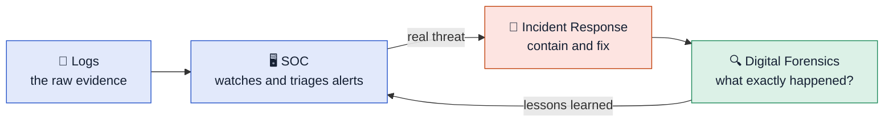

# 🔵 Defensive Security Module

**Path:** TryHackMe · Cyber Security 101  
**Status:** ✅ Complete

This module covers how organizations **detect, investigate, and respond** to attacks: the blue team side of security.

## Rooms

| # | Room | Big idea |
|---|---|---|
| 1 | [Defensive Security Intro](01-defensive-security-intro.md) | What the blue team does and the main areas of defense |
| 2 | [SOC Fundamentals](02-soc-fundamentals.md) | How a Security Operations Center runs: people, process, technology |
| 3 | [Digital Forensics Fundamentals](03-digital-forensics-fundamentals.md) | Collecting and examining evidence without changing it |
| 4 | [Incident Response Fundamentals](04-incident-response-fundamentals.md) | The step-by-step process for handling an attack |
| 5 | [Logs Fundamentals](05-logs-fundamentals.md) | Reading the records systems keep, to find what happened |

## How the rooms connect

> [!TIP]
> **One-line summary:** Logs feed the SOC. The SOC spots the problem. Incident response stops it. Forensics explains it, and the lessons make the SOC better next time.
